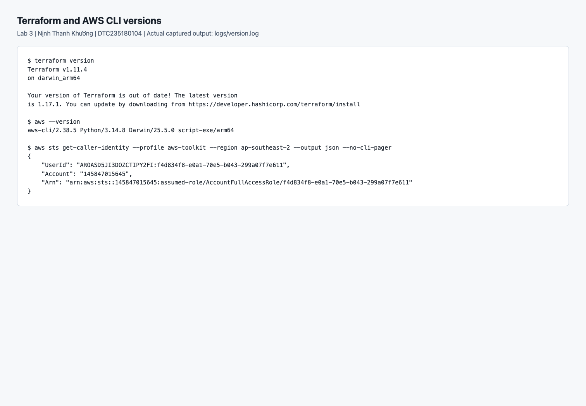
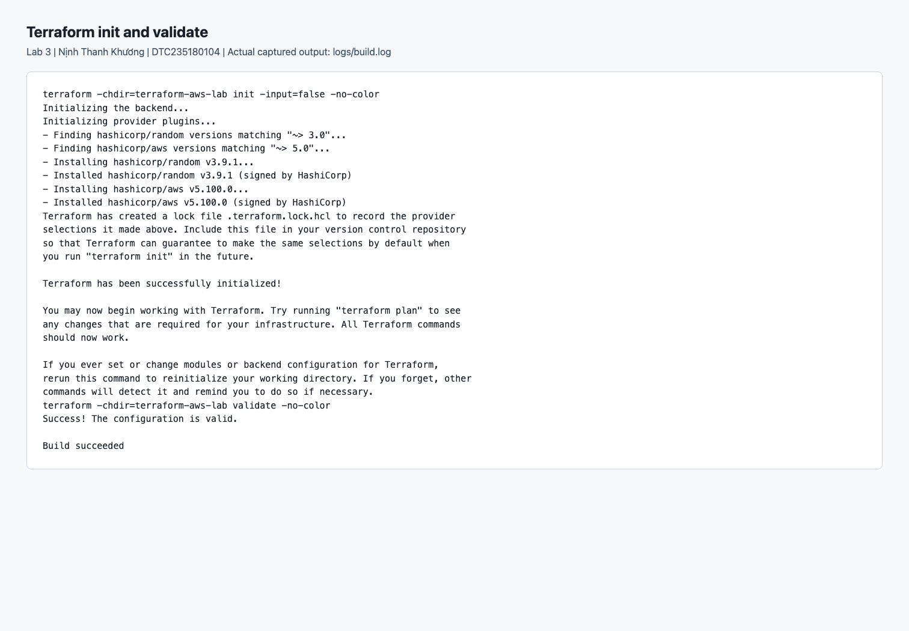
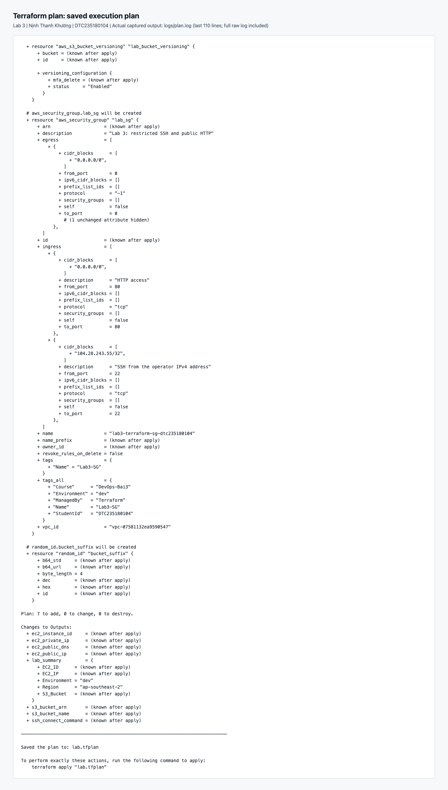
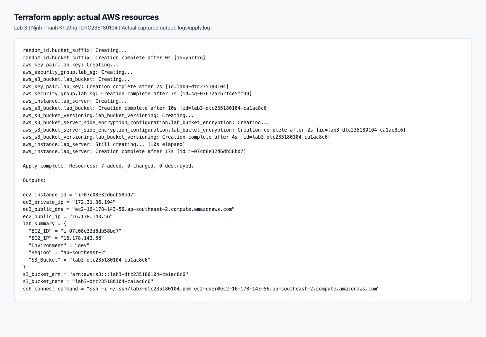
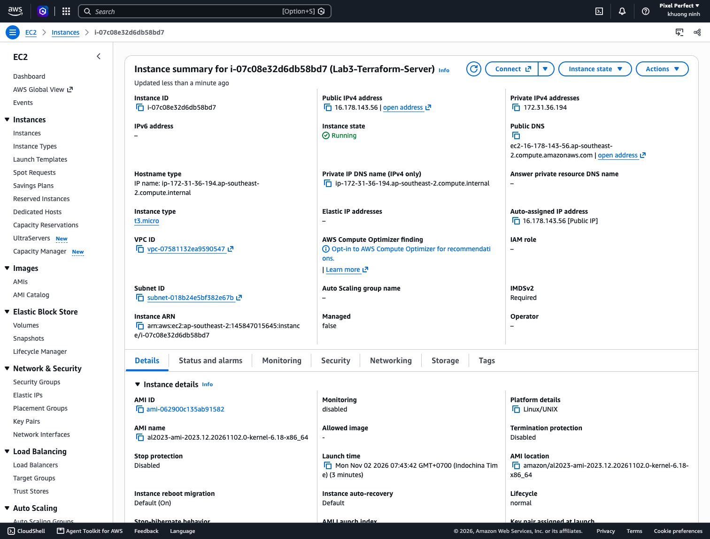
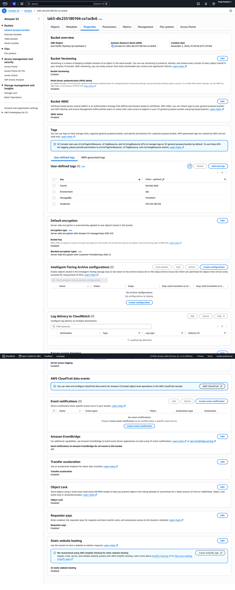
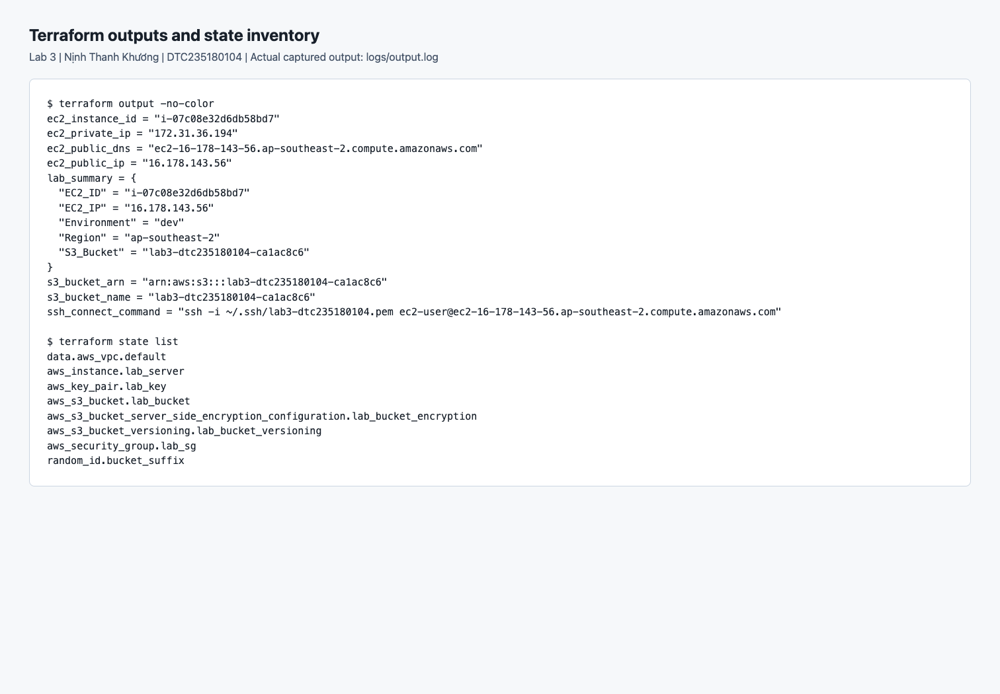
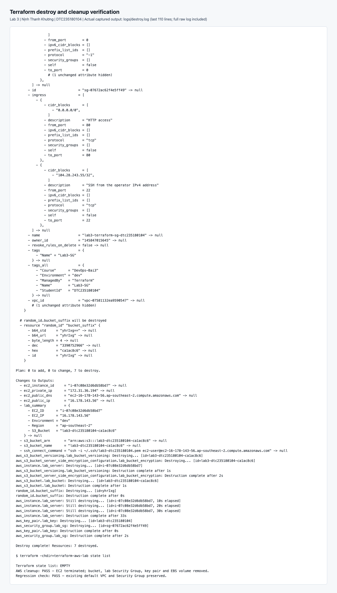

# Lab 3 — Cấp phát hạ tầng AWS bằng Terraform

**Họ tên:** Nịnh Thanh Khương · **MSSV:** DTC235180104 · **Lớp:** KTPM K22B

Thực hành ngày **02/11/2026** theo [hướng dẫn Bài 3](https://github.com/PhamThuongBlog/VHBTPM_DevOps_2026/blob/f4bb72310d326f84bf36b27550dd758f18f54c0a/Labs/B%C3%A0i%203/Lab3_HuongDan.md).

**Trạng thái:** Hoàn thành init → plan → apply → kiểm chứng → destroy. Đã dọn bảy resource của lab; Terraform state rỗng.

## 1. Môi trường và xác thực

| Thành phần | Giá trị thực tế |
|---|---|
| Máy thực hành | macOS ARM64 |
| Terraform | 1.11.4, binary chính thức đã kiểm tra SHA256 |
| AWS CLI | 2.38.5 |
| AWS provider | hashicorp/aws 5.100.0 |
| Random provider | hashicorp/random 3.9.1 |
| AWS profile | aws-toolkit |
| Project | Pixel Perfect — 145847015645 |
| Region | ap-southeast-2 — Sydney |
| Gói tại thời điểm kiểm tra | FREE, ACTIVE, còn 100 USD credit trước khi thực hành |

Đăng nhập bằng `aws login --profile aws-toolkit --region ap-southeast-2`; đã xác nhận qua `aws sts get-caller-identity`. Đây là phiên role tạm, phù hợp với The new AWS experience. Thông tin phiên được truyền trong bộ nhớ vào tiến trình Terraform bằng `scripts/terraform.py`, vì provider 5.x chưa đọc được định dạng `login_session`.



## 2. Cấu trúc và cấu hình

```text
terraform-aws-lab/
├── main.tf                 # Provider và bảy resource
├── variables.tf            # Region, AMI, instance type, key, bucket, environment, SSH CIDR
├── outputs.tf              # Tám output theo mẫu đề
├── terraform.tfvars        # Tên key, không chứa thông tin phiên/private key
├── .terraform.lock.hcl     # Phiên bản/checksum provider được khóa
└── tests/lab.tftest.hcl     # Mock tests, không tạo tài nguyên AWS
```

`main.tf` tái dùng tên resource của mẫu: `lab_server`, `lab_sg`, `lab_bucket`, `bucket_suffix`, `lab_bucket_versioning`, `lab_bucket_encryption`. Thêm `aws_key_pair.lab_key` để Terraform quản lý và xóa cả public key khi kết thúc lab. Private key nằm ở `~/.ssh/lab3-dtc235180104.pem`, ngoài bài nộp.

Các giá trị đã kiểm tra qua AWS API:

- AMI Amazon Linux 2023 x86_64 tại Sydney: `ami-062900c135ab91582`, lấy từ public SSM parameter `/aws/service/ami-amazon-linux-latest/al2023-ami-kernel-default-x86_64`.
- EC2 `t3.micro` có `FreeTierEligible=true`; `t2.micro` trong ví dụ có `FreeTierEligible=false` đối với project này.
- Dùng default VPC `vpc-07581132ea9590547`; giữ nguyên VPC và default Security Group có sẵn.
- SSH 22 giới hạn `104.28.243.55/32`; HTTP 80 theo yêu cầu đề. IP SSH cần cập nhật nếu mạng của người thực hành thay đổi.
- Root EBS gp3 mã hóa, tự xóa khi terminate; bắt buộc IMDSv2; CPU credits dùng `standard`.
- S3 bật versioning, AES256 và xác nhận cả bốn tùy chọn Block Public Access.

## 3. Quy trình init → plan → apply

Chạy từ thư mục gốc `devops-lab-03`:

Nếu thực hành lại trên máy mới, tạo SSH key dưới đây trước; trên máy hiện tại key đã tồn tại và được giữ ngoài repo. Cập nhật `ssh_allowed_cidr` nếu địa chỉ mạng thay đổi.

```bash
export PATH="$HOME/.local/bin:$PATH"
test -f ~/.ssh/lab3-dtc235180104.pem || ssh-keygen -t rsa -b 4096 -N '' -f ~/.ssh/lab3-dtc235180104.pem
make build
make test
make lint
python3 scripts/terraform.py plan -input=false -out=lab.tfplan
python3 scripts/terraform.py apply -input=false lab.tfplan
terraform -chdir=terraform-aws-lab output
terraform -chdir=terraform-aws-lab state list
```

Plan đã được lưu và kiểm tra trước khi apply: **7 to add, 0 to change, 0 to destroy**. Apply dùng chính saved plan đó:

```text
Apply complete! Resources: 7 added, 0 changed, 0 destroyed.
```





## 4. Kết quả tài nguyên và outputs

Các ID/IP dưới đây là bằng chứng của lần thực hành, không phải cam kết giữ endpoint hoạt động sau bước destroy.

| Thành phần | Kết quả |
|---|---|
| EC2 instance | i-07c08e32d6db58bd7 |
| Public IPv4 | 16.178.143.56 |
| Private IPv4 | 172.31.36.194 |
| Public DNS | ec2-16-178-143-56.ap-southeast-2.compute.amazonaws.com |
| Security Group | sg-07672ac62f4e5ff49 |
| SSH key pair | lab3-dtc235180104 |
| S3 bucket | lab3-dtc235180104-ca1ac8c6 |
| S3 ARN | arn:aws:s3:::lab3-dtc235180104-ca1ac8c6 |
| Environment | dev |

Đã lưu đủ tám outputs: instance ID, public IP, public DNS, private IP, bucket name, bucket ARN, SSH command và `lab_summary`.





## 5. Kiểm chứng

`make build` đã kết thúc bằng `Build succeeded`. Bộ kiểm thử gồm một unit test về cầu nối credentials và ba Terraform mock runs: cấu hình hợp lệ, từ chối sai Region, từ chối SSH `0.0.0.0/0`.

Hai vòng kiểm chứng AWS thật, mỗi vòng **8 API reads chạy tối đa 6 tiến trình đồng thời và 15 assertions**, đều PASS: đúng project, EC2 running, đúng loại/AMI/IP/DNS, IMDSv2, gắn đúng Security Group, SSH /32, HTTP 80, EBS mã hóa, key pair, S3 versioning/AES256/Block Public Access. Xem [verification.log](logs/verification.log) và JSON trả về của từng vòng trong `logs/`.

Plan chạy lại sau apply trả **No changes. Your infrastructure matches the configuration.** Cấu hình được review độc lập trước apply, không phát hiện lỗi quan trọng. Chưa kiểm thử đăng nhập SSH vào guest OS; kết quả SSH /32 ở trên là kiểm tra quy tắc Security Group qua AWS API.

Ảnh 01–04, 07–08 là ảnh chụp trình duyệt hiển thị nguyên văn log lệnh đã thực thi; raw logs đi kèm để đối chiếu. Ảnh 05–06 được chụp trực tiếp từ AWS Console đã đăng nhập, không dựng lại giao diện.

## 6. Dọn dẹp

```bash
python3 scripts/terraform.py destroy -input=false
terraform -chdir=terraform-aws-lab state list
```

Kết quả thực tế:

```text
Destroy complete! Resources: 7 destroyed.
Terraform state list: EMPTY
AWS cleanup: PASS — EC2 terminated; bucket, lab Security Group, key pair and EBS volume removed.
Regression check: PASS — existing default VPC and Security Group preserved.
```

Đã đối chiếu danh sách tài nguyên trước/sau bằng AWS API; xem [cleanup.json](logs/cleanup.json). AWS có thể còn hiển thị bản ghi EC2 ở trạng thái `terminated` một thời gian; đó không phải instance đang chạy. Giữ state cục bộ để lưu lịch sử, loại trừ khỏi ZIP theo đề.



## 7. Bài nộp và khác biệt với ví dụ

File nộp: `Lab3_NinhThanhKhuong_DTC235180104.zip`, gồm code Terraform, ảnh, raw logs, thông tin sinh viên và báo cáo này. ZIP loại trừ private key, credentials, state, saved plan, `.terraform`, `__pycache__` và Git internals.

Region của project là Sydney nên thay AMI/Region trong ví dụ; giữ provider 5.x của đề và dùng AWS CLI xuất phiên tạm. Mẫu định nghĩa sáu resource nhưng đoạn output minh họa ghi bảy; bài này có đúng bảy resource do quản lý thêm SSH public key. SSH được giới hạn /32 thay vì mở toàn Internet. Bỏ qua phần mở rộng đổi Region và tạo năm EC2 để giữ đúng phạm vi bài cơ bản.
